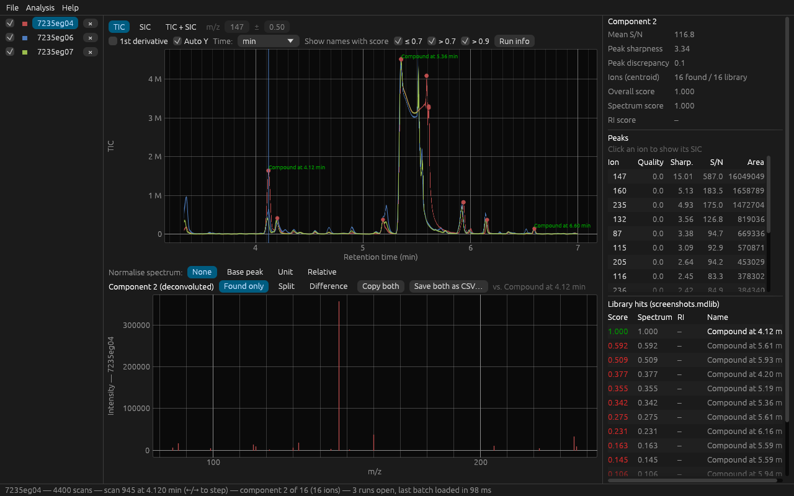
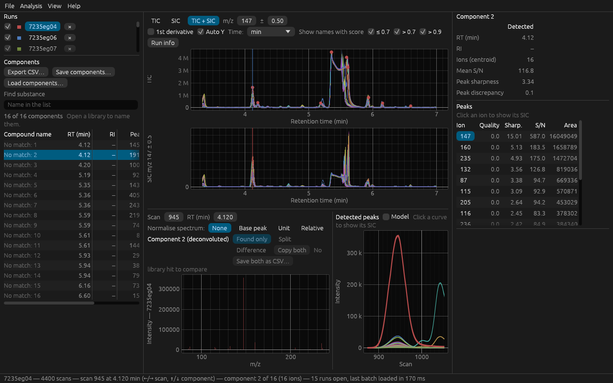
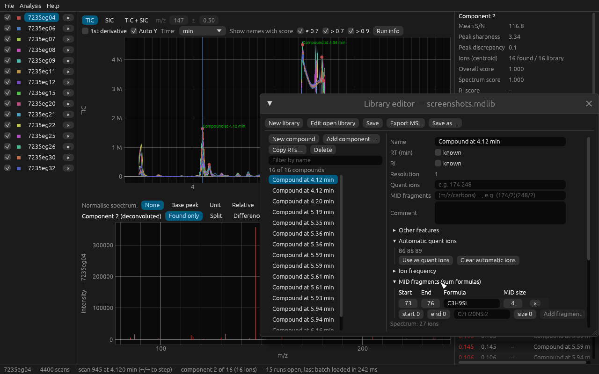
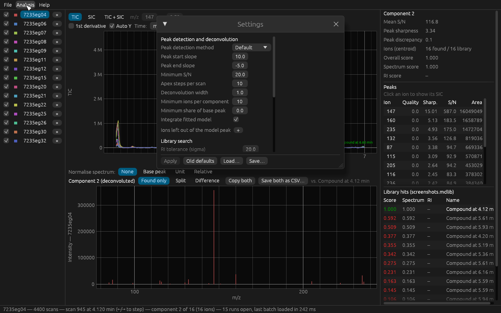
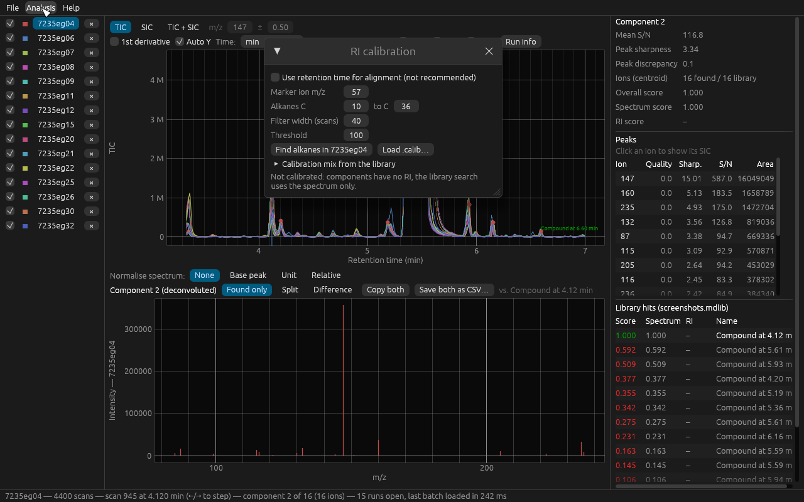
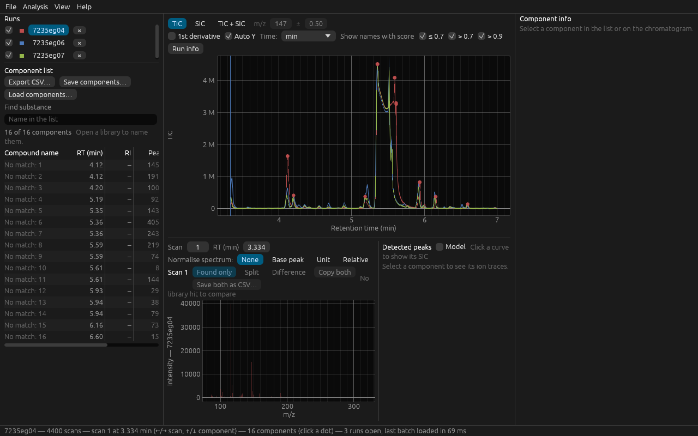
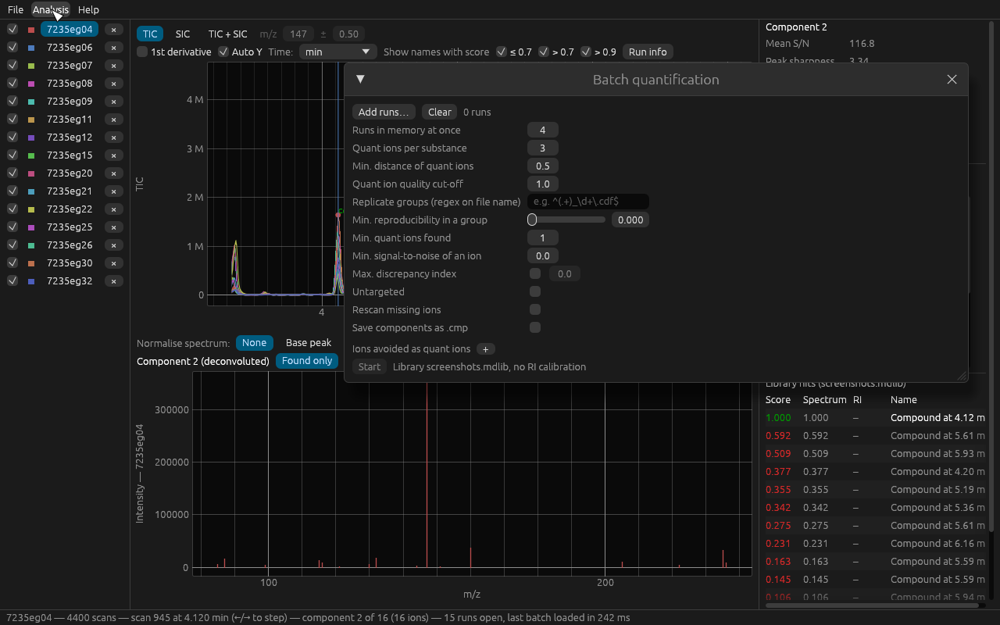

# MetaboliteDetector

Deconvolution, identification and quantification of GC/MS metabolomics data. A Rust rewrite of
MetaboliteDetector 3.3 that reads its old files and runs natively on Windows and Linux (macOS from source),
without R or Qt installs.



## Install

Download from the [Releases page](https://github.com/DcBexter/MetaboliteDetector/releases):

| File | For |
|------|-----|
| `.msi` | Windows installer: installs for the current user without admin rights, adds Start menu and desktop shortcuts |
| `.exe` | Portable Windows app, runs without installing |
| `.tar.gz` | Linux: the app and `md-cli` (built on Ubuntu 24.04, needs glibc 2.39 or newer) |

The app updates itself: **Help → Check for updates…**, and once a day at start it checks by itself
(switch it off under Help). An update installs only after you click, is verified against the release's
SHA-256 checksums and restarts the app.

From source (any OS with Rust): `cargo run --release -p metabolite-detector`.

## Example data

15 public GC-MS runs (~90 MB, not in git):

```powershell
.\example-data\fetch.ps1
```

On Linux/macOS: `example-data/fetch.sh`. The runs land in `example-data/TargetSearchData/inst/gc-ms-data/`.
Their library is `library.txt` in the same folder (TargetSearch format, RI on its FAME scale in ms): open it with **File → Open library…** or pass it to `md-cli --library`.
These runs record 20 scans/s. The **Deconvolution width** in **Settings** is on **Auto** and follows the scan
rate (10 scans here; the old 3.3 always used 1, which cuts most substances into pieces), so 9 of the 12
substances are found in at least one run; **Minimum ions per component** 5 finds them in more runs. Settings
imported from 3.3 set the width to 1: tick **Auto** again. Search without RI calibration: an alkane calibration
does not fit the library's FAME scale (a loaded `.calib` on that scale also needs **RI tolerance (sigma)** 2000).
For `md-cli`, save these settings with **Save…** while a run is shown and pass the file with `--settings`.

## Load runs

**File → Open chromatograms…** (or the button on the start screen), or pass files on the command line.
Supported: ANDI-MS NetCDF (`.cdf`, `.nc`), old MetaboliteDetector caches (`.bin` + `.idx`) and FastFlight
raw data (`MsData.FFT`). Pick several files to overlay them; each is analysed in the background.

- **Runs** (left, top): tick a run to show it, click its name to make it the active run, × closes it.
- **Component list** (left, below the runs): every component of the active run, see
  [Results of one run](#results-of-one-run).
- **Chromatogram** (centre): **TIC**, **SIC** (m/z ± tolerance) or **TIC + SIC**. Red dots are the detected
  components, with a triangle for each on the time axis as a larger click target; click near one to select
  it, ←/→ steps through scans. The buttons above the plot zoom (**+**, **−**, **All**), move (◀ ▶) and
  toggle the crosshair; the coloured triangles filter the names by score; **?** explains the controls.
  Scroll and drag move the view, Ctrl + scroll zooms, double-click resets; another active run starts unzoomed.
- **Spectrum** (below): the selected component, deconvoluted, or the scan typed in under **Scan** or
  **RT**. **Normalise spectrum** switches between raw, base peak, unit and relative scale; with a library
  hit, **Split** and **Difference** compare both spectra. Click an ion to show its SIC.
- **Detected peaks** (beside the spectrum): each ion of the selected component over its scans; **Model**
  adds the modelled peak profiles. Click a curve to show that ion's SIC.
- **Component info** (right): the component next to its library entry (RT, RI, ions, S/N, sharpness,
  scores), its ion peaks (click an ion to show its SIC) and the library hits.

Drag the borders between the areas to resize them; **View** shows or hides each one.



Old `.cmp` (saved components) and `.calib` files next to a run are picked up automatically.

## Load a library

**File → Open library…** loads `.mdlib`, old `.lbr`, AMDIS `.msl` and NIST `.msp`/`.sdf`. Every component
is then searched against it; hits show in the component panel and as names in the chromatogram
(**Show names with score** filters them). **File → Open NIST library…** loads a second, large NIST library
for a "NIST search" of the selected component only; the normal library stays.

**File → Library editor…** creates or changes a library: **New library** or **Edit open library**, then
**Add component…** takes the selected component from the run. Per compound: name, RT, RI, quant ions,
MID fragments and a comment. **Save** and **Save as…** write the text format `.mdlib`; **Export MSL** (next to Save as…) writes AMDIS MSL.



## Settings and RI calibration

**Analysis → Settings…** holds peak detection, deconvolution and library search parameters. Change values,
then **Apply**. **Load…** / **Save…** read and write the old 3.3 settings file; **Old defaults** fills in
the 3.3 defaults. Hover over a setting for what it does and its old key (e.g. `AN_PEAK_THRESHOLD_BEGIN`).



**Analysis → RI calibration…** gives components a retention index, so the library search scores RI as well
as the spectrum: **Find alkanes in** the active run (marker ion, carbon range), use a calibration mix from
the library, or **Load .calib…**. **Save .calib…** stores it next to the run.



## Results of one run

The **component list** on the left lists every component of the active run with RT, RI, peak area, S/N and
number of ions, also without a library ("No match: 3"); with a library it adds the name, scores and quant
ions. Click a header to sort, a row (or ↑/↓) to select the component; type in **Find substance** to
filter. **Export CSV…** saves the list, **Save components…** writes an old-style `.cmp`.
**Analysis → Run info…** shows file, instrument and scan details.



## Quantify many runs

**Analysis → Batch quantification…** finds the library's substances in many runs:

1. Open a library (and an RI calibration, if you use RI).
2. **Add runs…**, set quant ions and filters. **Replicate groups** is a regex on the file name, e.g.
   `^(.+)_d+.cdf$`, so runs of one group are compared. If the file names do not tell the group, load a
   sample table (CSV/TSV, e.g. `samples.txt` with `CDF_FILE` and `TIME_POINT`) with **Table…** and pick its
   file and group columns; the table wins for the runs it names.
3. **Start**. The result is a substance × run table; **Export CSV…** writes it (UTF-8, opens in Excel;
   R: `scripts/r/load_results.R`).



**Analysis → Biomarker statistics…** works on the batch table: group comparison, box plots and PCA.

**Analysis → Mass isotopomer distributions…** is for labelling experiments: **Add…** runs, and it computes
the isotopomer distributions of the library's MID fragments (set in the library editor) across them.

Further tools under **Analysis**: **Natural isotopes…** (M+0, M+1, … of a sum formula) and **TOF
calibration…** (m/z calibration of FastFlight raw data, saved as `.mzcalib`).

## Export

- **File → Export chromatogram / Export spectrum**: the plotted values as CSV or copied, the plot as PNG,
  SVG or PDF.
- **File → Export as NetCDF**: the active run as profile, centroided or nominal-mass ANDI-MS file.
- Every table window has its own **Export CSV…**.

## Big studies without a window: `md-cli`

`md-cli` (in the Linux package, or `cargo run --release -p md-cli --`) runs the batch quantification
headless and writes the substance × run table as CSV:

```sh
md-cli --library library.msl --settings algorithms.settings --calibration run.calib \
    --replicates '^(.+)_\d+\.cdf$' -j 8 -o table.csv study/*.cdf
```

`md-cli --help` lists all options; details in [docs/architecture.md](docs/architecture.md#command-line-md-cli).

## Development

- Architecture, performance rules, build and test commands: [docs/architecture.md](docs/architecture.md)
- Milestones: [docs/roadmap.md](docs/roadmap.md)
- UI review and how these screenshots are made: [docs/ui-quality.md](docs/ui-quality.md)
- What the old 3.3 version did (reverse-engineered): [docs/reverse-engineering/](docs/reverse-engineering/)
- Contributing: [CONTRIBUTING.md](CONTRIBUTING.md), [AGENTS.md](AGENTS.md); workflow kit setup:
  [docs/workflow-kit.md](docs/workflow-kit.md)

License: [MIT](LICENSE).
