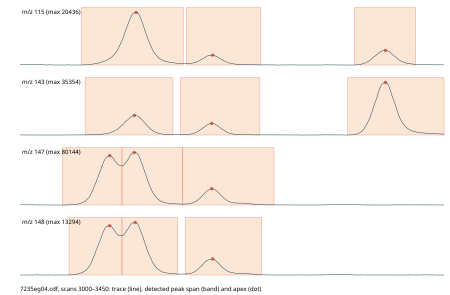

# Architecture

MetaboliteDetector is being rebuilt in Rust as a native desktop app for Windows, Linux and macOS.
The old Qt5/C++ version (3.3, 2020) is the behavioural reference; its features are listed in
[reverse-engineering/feature-inventory.md](reverse-engineering/feature-inventory.md).

## Decisions

| Topic | Decision | Why |
|-------|----------|-----|
| Language | Rust (edition 2024) | Memory-safe, fast numerics, one static binary per OS, no runtime to install. |
| GUI | [egui](https://github.com/emilk/egui)/eframe + egui_plot | Pure Rust, single executable, interactive plots that handle large series. Chosen by the maintainer 2026-10-19. |
| File dialogs | rfd | Native dialogs on every OS. |
| NetCDF | `netcdf3` (pure Rust) | ANDI-MS files are NetCDF-3; no libnetcdf/HDF5 C dependency to ship on Windows. |
| Parallelism | rayon | Data-parallel loops over scans, ions and files. |
| R console | Not ported directly | RInside tied the old app to a Linux R install. Decision (#26): no embedded R. The batch table exports as CSV (`Table::write_csv`, shared by app and the planned md-cli) and `scripts/r/load_results.R` loads it as `data` like the old console. Optional embedded scripting later. |

## Layout

```
Cargo.toml              workspace: members crates/*, shared dependencies and lints, release profile
rust-toolchain.toml     pinned Rust version with clippy and rustfmt; Renovate raises it
crates/md-core/         library: data model, import/export, analysis algorithms (no GUI deps)
  src/lib.rs            Chromatogram (flat ANDI-style arrays), TIC/SIC, plot decimation
  src/andi.rs           ANDI-MS NetCDF import with input validation, NetCDF export
  src/diskscan.rs       old raw-data cache (.bin + .idx) reader
  src/library.rs        compound libraries: old .lbr (version 2) reader, AMDIS MSL import/export,
                        library text format (.mdlib) read/write
  src/peaks.rs          ion traces (ion-major index), noise, baseline and peak detection per trace
  src/deconv.rs         deconvolution of ion-trace peaks into components with spectra
  src/isotope.rs        formula parser and natural isotope patterns (M+0, M+1, …) from a built-in table
  src/ri.rs             retention index: RT ↔ RI calibration, marker search, RT shift, .calib file
  src/search.rs         library search: spectrum and RI scores, one-to-one assignment of components
  src/batch.rs          batch quantification: many runs → substance × run table, quant ions
  src/spectrum.rs       spectrum normalisation (none, base peak, unit, relative)
  src/csv.rs            CSV writer for plotted series
  examples/perf.rs      performance smoke test on synthetic large runs
  examples/batch.rs     batch quantification timing on real files
  tests/                integration tests (example data, golden test against the old version)
crates/md-app/          egui desktop app (binary `metabolite-detector`), drawing only
  src/main.rs           entry point, `App` state and one call per UI area in `ui`
  src/menu.rs           top menu bar (File, Analysis)
  src/status.rs         bottom status bar
  src/run_list.rs       left list of the open runs
  src/central.rs        centre: TIC/SIC plots, scan cursor, spectrum
  src/loading.rs        opening files, load polling, SIC jobs
  src/jobs.rs           `spawn` and `poll_job` for background threads
  src/calibration.rs    RI calibration window (alkane search, .calib load/save)
  src/isotopes.rs       natural isotope calculator window
  src/export.rs         spectrum normalisation picker, CSV and PNG export of the shown plots
  src/identify.rs       library loading, hit labels on the TIC and the hit list of a component
  src/library_editor.rs library editor window (compounds, RI, quant ions, FRAG, comments; saves .mdlib)
  src/library_editor/add.rs  its "Add component" and "Copy RTs" dialogs (#80)
  src/batch.rs          batch quantification window and result table
crates/md-cli/          headless batch quantification (binary `md-cli`), depends on `md-core` only
  src/main.rs           options, settings/library/calibration loading, CSV output
  tests/                runs the binary on the 15 example runs
docs/reverse-engineering/  evidence from the old binary (features, algorithms, file formats)
```

Planned additions: modules in `md-core` for normalisation, MID and statistics.
All analysis code lives in `md-core` so the GUI, CLI and tests share it.

Each crate follows the Cargo layout: `src/` for code, `tests/` for integration tests, `examples/` and
`benches/` for runnable measurements. A new crate goes under `crates/` and takes its versions, edition,
dependencies and lints from the workspace (`*.workspace = true`, `[lints] workspace = true`).

The crate boundary is the enforced architecture: `md-core` has no GUI dependency, so analysis code cannot
reach into the UI. SonarQube Cloud's Architecture view does not support Rust (only Java, JavaScript,
TypeScript, Python and C#), so it shows no architecture for this project.

### Code analysis

The Ubuntu job of `.github/workflows/ci.yml` runs SonarQube Cloud on `main` and on pull requests, reusing its own build: it measures coverage with
`cargo llvm-cov` (LCOV) and hands Sonar its Clippy JSON report; Sonar does not run Clippy itself. `sonar-project.properties` marks each crate's
`src/` as code and `tests/`, `examples/` and `benches/` as test code. Coverage counts `md-core` only: `md-app` just draws, so logic that
needs tests belongs in `md-core`. Automatic Analysis cannot analyze Rust,
so it must be off; the scan step is skipped until the repository secret `SONAR_TOKEN` exists.

## Performance rules

Large studies (hundreds of runs, tens of millions of points each) are the normal case.

1. **Compact storage.** Spectra are flat `f32` arrays with scan offsets (≈ 8 bytes per data point),
   matching the old `GCMSDiskScan<int, float>`. Accumulate sums in `f64`.
2. **Never block the UI.** File loading and every analysis step run on worker threads; the UI polls
   results and shows progress. Long jobs must be cancellable.
3. **Draw proportional to pixels, not data.** Line plots go through `md_core::decimate`
   (min/max per pixel bucket of the visible range), so peaks stay visible at any zoom.
4. **Parallel by default.** Per-scan, per-ion and per-file work uses rayon.
5. **Index once, query many.** m/z is sorted within each scan (binary search for SICs). Peak detection
   and deconvolution share one ion-major index per run (`IonTraces`) instead of rescanning spectra per ion.
6. **Measure.** `examples/perf.rs` reports timings; each new algorithm adds a case, and PRs that
   touch hot paths report before/after numbers against the table below.
7. Memory-mapped or streamed access (like the old disk scan) is added when real runs exceed RAM;
   the cut-off is recorded as a `shortcut:` comment in `andi.rs`.

Measured 2026-10-19, release build, 36 000 scans × 500 ions (18 M points, 137 MiB):

| Operation | Time |
|-----------|------|
| TIC | 2.0 ms |
| SIC (one m/z) | 1.0 ms |
| Decimate TIC for drawing | 0.05 ms |
| Overlay frame: decimate TIC + SIC of 15 runs | 0.8 ms |
| Ion traces (index, 500 traces) | 26 ms |
| Peaks in all 500 traces (300 000 peaks) | 20 ms |
| Deconvolution (12 000 substances of 25 ions) | 19 ms |
| Library search, 1 000 components × 10 000 entries, cutoff 0.8 | 31 ms |
| Library search, same, cutoff 0 (9 M hits kept, like the old GUI) | 250 ms |
| Batch, one run end to end (traces, peaks, deconvolution, search) | 300 ms |

Real runs (TargetSearchData, 4 400 scans, ~745 000 points, 6 MB `.cdf`): read + TIC 13–25 ms per
file; all 15 runs in 0.27 s; ion traces + peak detection 4–8 ms per file, 630–950 peaks in 236 traces;
with deconvolution 5–10 ms per file, 13–20 components of 15–21 ions
(`cargo test --release -p md-core --test example_data -- --nocapture`).
The app opens all 15 as an overlay in 0.06–0.21 s (one loader thread per file; status bar shows the time).
The whole file is read into memory first because `netcdf3` seeks per record (1.8 s per file on a
plain `File`).

## Peak detection

`md_core::peaks` ports the old `DefaultPeakDetector` ([algorithms.md](reverse-engineering/algorithms.md)
§2–3): `IonTraces::new` builds the ion-major index once per run, `IonTraces::detect_peaks` runs the
detector on every trace in parallel. The index needs masses × scans × 4 bytes (the example runs: about
0.1 GiB); `IonTraces::new` returns `TooLarge` above `MAX_TRACE_BYTES` (8 GiB) before allocating, so a
corrupt file cannot exhaust memory. The app shows that error in place of the run. `PeakSettings::default()` holds the old `AN_*` defaults.
`detect_peaks_matched` and `matched_filter` port the old `MatchedPeakDetector` and its filter, which the
old app only uses in the RI calibration dialog (and deconvolution, §4.5).



Conscious deviations from the old app; the golden test (below) shows that none of them changes the
peaks of the example runs:

- **Traces per nominal mass.** m/z is rounded and points of one nominal mass in a scan are summed. The
  old app's trace construction for ANDI data is unknown; the example runs are unit-resolution, so this
  matches them. High-resolution data needs exact-mass traces and `reorderPeaks` (§4.2).
- **Noise factor 1.0.** `GCMSAnalyzer` sets the detector's noise factor from
  `DataProvider::getGlobalNoiseFactor` (§2.3). On all 15 example runs the old app logs
  "Error determining nf. Using nf=1", so 1.0 is what it uses there. Data where the old app finds another
  noise factor would differ. The noise factor and MAD of `analyzeBaseline` are not computed because the
  detector never reads them.
- **f32 intensities instead of int.** Only the SG smoothing and the matched filter output are truncated
  to integers like the old int filters. S/N is not rounded to 8 significant digits.
- **Precise apex ties round down.** The old app fits the parabola with `gsl_multifit_linear` in absolute
  bin coordinates; at an exact half-step tie its rounding error decides the direction. Here the vertex is
  exact and ties round down, which the old app does in 217 of 267 ties on the example runs. On a flat top
  (three equal values) the old fit returns an arbitrary vertex near the apex; here there is no precise apex.
  This only moves peaks between deconvolution histogram bins (golden test).
- **No progress or cancel per 100 traces.** A whole run takes milliseconds (table above).
- **Border extension off** like the old default (`setPeakBorderExtensionEnabled` has no known caller),
  so the extension code is not ported.

## Deconvolution

`md_core::deconv::deconvolute` ports the old `deconvoluteChromatogram` ([algorithms.md](reverse-engineering/algorithms.md)
§4.4–4.9): the apex intensities of all peaks go into a histogram of `AN_NUMBER_BINS` bins per scan, the
matched filter (`AN_DECONVOLUTION_WIDTH` scans) marks regions above 5, and each region becomes a component.
Its model peak is the sum of the sharpest clean peaks (quality ≤ 10, at most a quarter); every ion trace is
fitted as `c0 + c1 * scan + c2 * model`, and `c2 * max(model)` is that ion's height in the spectrum.
Components are fitted in parallel. `DeconvSettings::default()` holds the old `AN_*` defaults. The app runs
peak detection and deconvolution after loading and marks each component on the TIC; a click near a dot
shows its deconvoluted spectrum.

The old quirks are kept on purpose; with them, 241 of 246 old components match exactly (golden test below): the first
and last bin of a region are added twice, so a peak can appear twice in a component and counts twice
towards `AN_MIN_PEAK_NUMBER`; the model peak sums raw intensities including the baseline, so all heights
of a spectrum share one scale factor.

Conscious deviations:

- **No precise apex → apex scan.** Where the parabola fit was refused, the histogram uses the apex scan.
  What the old field holds then is unknown.
- **Collinear fits drop the peak.** The old code uses an SVD (`gsl_multifit_linear`), which also returns a
  minimum-norm fit when model and scan are collinear; here those peaks are skipped.
- **Filter edges are zero-padded** (old edge handling unknown, §4.11), and `roundSignificantFigures` is
  re-implemented (round to 8 significant digits).
- **No `reorderPeaks`** (unit-mass data only, see peak detection).
- `AN_MIN_HEIGHT_BP` has no static value in the old binary (zero-initialised), so the default keeps all ions.

## Retention index

`md_core::ri::RiCalibration` ports the old `RICalculator` ([algorithms.md](reverse-engineering/algorithms.md) §6):
RT → RI is piecewise linear through the calibration points, and outside them the first or last segment
continues (§6.2). `rt` is the inverse (§6.3), `component_ris` gives the RI of each component at its apex
scan (§6.4). Times are seconds like `Chromatogram`; the `.calib` file holds milliseconds.

Calibration from a run: `marker_peaks` runs the matched detector (§3.3) on the marker ion trace (± 0.5)
and takes the highest raw scan of each peak. `series_points` gives the n highest peaks, in time order, the
RIs of an alkane series (C10, C11, … → 1000, 1100, …); `window_points` takes the highest peak in a known
time window per marker. The app's *Analysis → RI calibration* window finds alkanes in the active run
(m/z 57, C10–C36 by default) or loads/saves a `.calib`; the calibration applies to all open runs and to the
library search, and the status bar shows the RI of the scan or selected component.

Calibration mix (old wizard, [algorithms.md](reverse-engineering/algorithms.md) §6.8): the user picks library
compounds with RI; the calibration run's components are searched against them by spectrum only, and
`match_mix` assigns them as the old `matchCompounds` does (mix by ascending RI, each takes the next component
in time order that has it as a hit). The result is an editable table (use / RT / RI); substances not found
are unused rows. A change takes effect when the field is left or the drag ends and builds a new
`RiCalibration` (invalid tables keep the old one and show the error). Each run can take over the table as
its own calibration and save it as `.calib`; runs without one use the table. Deviations: the old table offered
the components' times in a combo box, here the time is typed; substances with the same RI are both kept.
*RT only* (old "Use Retention time for chromatogram alignment (not recommended)", with its warning):
`RiCalibration::identity()` (RI = time in s) and `PreparedLibrary::new_rt_only` (library RI = library RT in s)
make the library search and the reference shift compare times. The RT/1000 fallback of §5.6 is still not
ported for the normal mode.

Checked against TargetSearch on the example data (`tests/example_data.rs`): its FAME markers (m/z 87 in
the windows of `rimLimits.txt`) give the RI of every scan in `RI_*.txt` to within 0.01 in 14 of 15 runs.
In `7235eg06` TargetSearch took a peak at 321.1 s as the middle marker, where m/z 87 reaches 36 512;
the marker peak at 311.1 s, as in all other runs, reaches 221 839. Filter width 40 scans, threshold 100.

RT shift correction (§6.5): `pick_reference` chooses the substance with the best library score for the
reference near its RI, `shifted_to` shifts the calibration so it lands on the library RI.
`md_core::search::shift_to_reference` combines them with the library search: window `3 · LS_RI_DIFF`, score
= overall score of the reference among the component's hits. Because that score contains the RI score, a run
shifted by more than about half a sigma (10 RI) no longer reaches the default cutoff 0.8; the old code
behaves the same. In the app the calibration window offers a reference substance (library compounds with RI)
and the cutoff once a calibration and a library are loaded. Each run's identification job then shifts the
calibration onto the reference, searches with the shifted RIs and keeps the shifted calibration for the
status bar; the window lists the shift per run, or that the reference was not found (then the run uses the
unshifted calibration). Reference and cutoff are part of the `run.ident` key. Tests: a synthetic run 10 s
late (`search.rs`) and the example runs made 4 s late, where Glycine 3TMS lands on its `lib_aa` RI again and
the shift grows by exactly 4 s (`tests/example_data.rs`).

Conscious deviations:

- **At least two points, RI rising with RT.** The old code accepted any table and returned -1 below two
  points; a falling table has no inverse. A slope outside 1e-9 to 1e9 RI per second would overflow on
  extrapolation. Such calibrations and `.calib` files are rejected with an error.
- **Above the last point** the old code dereferenced `end()` (undefined, §6.2); here the last segment
  continues, as for every other time above the range.
- **The shift does not stack.** The old code subtracted the previous shift once more (§6.5), so only
  the first correction was exact.
- **`.calib`** is read as `<rt in ms> <RI>` per line (any whitespace, blank lines skipped; the ms unit
  is inferred, file-formats.md §4.1) and written with full precision instead of 6 significant digits.
  Reading is a trust boundary: at most 1 MiB, UTF-8, two finite numbers per line, errors name the line.
- **Marker apex** is the highest raw scan of the matched-filter peak; the old dialog's choice is unknown (§6.7).

## Library search

`md_core::search` ports the old `LibrarySearch` ([algorithms.md](reverse-engineering/algorithms.md) §5).
`PreparedLibrary::new` bins, mass-filters and scales every library spectrum once (mass² · intensity^0.6 with the
default `LS_SCALE_FACTOR_*`), like the old pre-scaled cache. `library_hits` scores one spectrum against every
entry: the pure score is a cosine over all peaks of both spectra, the impure score over the library peaks only
(peaks without a partner are weighted with `LS_SCALE_FACTOR_NO_MATCH`), the spectrum score is
`0.5 · pure + 0.5 · impure`, and with an RI the overall score is `(spec² · ri)^(1/3)`, where the RI score is a
Gaussian with sigma `LS_RI_DIFF` that is zero beyond 3 sigma. `map_compounds_to_library` searches all
components in parallel and then assigns library compounds greedily by best overall score, each library compound
and each component at most once. `SearchSettings::default()` holds the old `LS_*` defaults.
With nominal masses each pair is one pass over the library peaks with a dense lookup into the component
spectrum, so no fragment pre-filter is needed (table above).

The app opens a library with File → Open library (or a `.mdlib`/`.lbr`/`.msl` path on the command line), identifies every
open run on worker threads, writes the assigned name at each component on the TIC (green above 0.9, orange
above 0.7, red otherwise, like the old app) and lists the best hits of the selected component with overall,
spectrum and RI score. With an RI calibration the component RIs (`component_ris`) go into the search; setting,
loading or clearing the calibration re-identifies every run, because `run.ident` remembers the library and
calibration (`Arc`s, compared by pointer) it was computed with. `tests/example_data.rs` checks this with
`lib_aa.lbr` (`MD_LBR_SAMPLE`): the example runs have no alkanes, so their alkane calibration is bridged over
Valine 2TMS and Threonine 3TMS (FAME RI from TargetSearch's `library.txt` → time in the run); Leucine 2TMS,
Glycine 3TMS and Serine 3TMS are then assigned with RI scores of 0.94–0.99.

Conscious deviations:

- **No RI → spectrum only.** Without a calibration, or when the library entry has no RI, the overall score is
  the spectrum score alone (with `use_spec` off there is then no hit). The old code then compares retention
  times / 1000 with the same sigma instead (§5.6), and with `LS_USE_RI` on it drops every entry more than 60 s
  away. That is not ported: times of different instruments and temperature programs are not comparable. The
  sample library `lib_aa.lbr` lists Glycine 3TMS at 418 s, the example runs elute it at 313 s, so the old rule
  would remove the correct hit there.
- **Nominal mass.** Library spectra are rounded to nominal mass and intensities of one mass are summed, because
  the old `getBinnedCentroidCompound` is not decoded (§5.9) and components are unit-mass. Matching is then exact,
  which makes the old 0.01 m/z tolerance and its double-match quirk (§5.3) irrelevant. Negative intensities
  and masses below 0.5 are dropped.
- **Hits need a score above zero.** The old search keeps pairs with score 0 and may even assign them; here they are
  no hits. The cutoff is applied during the search; the app searches with 0 like the old GUI. A higher cutoff
  yields the same assignments above it, because the greedy assignment takes pairs in descending score.
- **Ties are deterministic**: lower library index, then lower component index (old: pointer order).
- `LS_USE_SCALED_LIB`, `LS_IDENTIFICATION_ALGORITHM`, the Wave score variants and the SQL fragment pre-filter are
  not ported (semantics unknown, §5.9).

## Batch quantification

`md_core::batch` finds the library substances in many runs (old `BatchQuantificator`, F10–F12) in two
passes. `scan_runs` reads each file, runs ion traces, peaks, deconvolution and library search (with RI if
a calibration is given) and keeps only the assigned substances with their ion integrals. Files go through
`parallel` worker threads, so at most that many runs are in memory; each run is analysed with rayon as
well. Progress is an atomic counter, cancelling stops before the next file, unreadable files are listed
and skipped. `table` then builds the substance × run table and is cheap, so the app re-filters without a
rescan:

- **Quant ions** per substance: the library's manual ions, else its automatic ones, else the old
  `autoQuantificationIonAssignment` (§7.2, fallback quirk kept) on the best-scoring run. The value of a
  cell is the summed integral of the quant ions found in that run.
- **Replicate groups**: the first capture group (else the whole match) of a regex on the file name.
- **Filters**: minimum quant ions found per cell, minimum reproducibility (share of runs in a group).

All 15 example runs against the TargetSearchData library (12 entries, converted to MSL), measured
2026-10-20 on a loaded machine: 1.1 s with 1 run in memory (33 MiB peak working set), 0.17 s with 4
(90 MiB), 0.10 s with 15 (189 MiB). 150 runs (the 15 ten times) with 4 take 2.6 s and stay at 82 MiB, so
memory depends on the runs in memory, not on the study size (`examples/batch.rs`). Reading the file
(~27 ms per run) is the largest share. Not ported yet (#58): the non-targeted mode, the SIC rescan of missing quant
ions (`ResultSeries::scanIons`, §4.0), the discrepancy index and `QUANT_EXCL_IONS` in the app.

### Command line (`md-cli`)

`md-cli` runs the same two passes without a window, for big studies on servers or clusters:

```sh
cargo run --release -p md-cli -- --library lib.msl --settings algorithms.settings --calibration run.calib \
    --replicates '^(.+)_\d+\.cdf$' -j 8 -o table.csv study/*.cdf
```

Runs are `.cdf`/`.nc` or old `.bin` files (shell globs expand them). `--settings` is the old settings file
(`GcmsSettings::from_bytes`): its `AN_*`/`LS_*` values drive peak detection, deconvolution and search, its
`QUANT_*` values are the quant defaults, which `--ions`, `--min-dist` and `--quality-cutoff` override.
`--replicates`, `--min-reproducibility` and `--min-ions` are the batch window's filters. The CSV is
`Table::write_csv` (`Substance,RT_s,Quant_ions,<run>...`, empty cell = not quantified); progress and
failed runs go to stderr, and the exit code is 2 if the table is complete except for unreadable runs.
Without `--settings` and `--calibration` the table equals the app's batch window with default settings
and no RI calibration. `crates/md-cli/tests/example_data.rs` checks this on the 15 example runs.

## Golden test

`crates/md-core/tests/golden_old_md.rs` compares peak detection and deconvolution with the old
MetaboliteDetector 3.3 (Linux) on the 15 example runs of `example-data/`; it passes without checking
anything when they are missing. The reference `crates/md-core/tests/data/old-md-3.3.tsv` holds the old peaks
(ion, first, apex and last scan, S/N) of 7235eg04, eg20 and eg32 and the components (apex scan, ions,
heights, integrals) of all 15 runs.

How the reference is made: `docs/reverse-engineering/tools/golden/make-reference.sh` (Linux or WSL, old
`.deb` installed) loads a small driver into the old binary with `LD_PRELOAD`. The driver replaces `main`
and calls the binary's own functions in the order of the GUI's "Detect components": `CdfImporter`,
`GCMSDiskScan`, `GCMSAnalyzer::detectAllPeaks(true, 10, 0.05)`, `deconvoluteChromatogram`. It uses the
static `AN_*` defaults compiled into the binary, which are also the values of a fresh config file. This
is the old code itself, not a re-implementation. The GUI export and `.cmp` files were not used because
they need clicks per run and `.cmp` holds no peak bounds. The script checks the binary's SHA-256, so
another build cannot silently produce a different reference. Neither the binary nor the example data are
committed.

Tolerances and their reasons:

| Compared | Tolerance | Reason |
|---|---|---|
| Peaks: ion, first, apex, last scan | exact | same algorithm and integer data |
| Peak S/N | 1e-5 relative | the reference prints 6 significant digits |
| Component ions and apex scan | exact for 242 of 246 | 4 known differences, see below |
| Ion height | ±1 | the old code rounds a few modelled heights the other way |
| Ion integral | 1e-5 relative | the reference prints 7 significant digits |

Remaining differences, all in deconvolution: 1 old component is missing, 3 differ by one or more ions,
and 1 has other heights. All 5 come from precise-apex ties that the old GSL fit rounds up (peak detection
deviations above): fed with the old precise apex values, the port matches all 246 components exactly.
A bit-exact copy of the GSL SVD would remove them, but GSL is GPL and this project is MIT.

The test fails when one of these counts grows.

The golden test found three porting errors in peak detection, now fixed:

- After an accepted peak the old loop steps back one scan, so a tailing peak starts right after the
  previous one.
- The apex search starts at the last rising scan, so a tie keeps the later scan.
- The baseline fit takes half of the distinct residuals (`std::map` keys), not half of all points, and
  the pivot tie goes to the right.

## Libraries

`md_core::library` reads the old binary `.lbr` libraries (gzip or raw, version 2, layout in
[file-formats.md](reverse-engineering/file-formats.md) §1) and imports and exports AMDIS MSL (§6).
Library files come from users, so reading is a trust boundary: every length is checked against the
remaining bytes before anything is allocated, check values are verified, gzip output is capped at 1 GiB,
and errors are returned instead of panics. Version 5 (the old writer's current version) and compounds
with peak records are rejected as not supported until a sample file shows their layout. Strings are read
as UTF-8, falling back to Latin-1. The unknown 40-byte block list (§1.3) is kept verbatim.
`tests/lbr_sample.rs` checks the sample library `lib_aa.lbr` from the old package when
`MD_LBR_SAMPLE` points to it; the file is never committed.

### Library text format (.mdlib)

Edited libraries are saved in a new text format, not as `.lbr`: the old writer's current version 5 is not
decoded (#41), and a text file can be read, diffed and repaired by hand. It needs no new dependency (no
serde in `md-core`), and unlike JSON it keeps NaN and infinity. `write_mdlib` and `parse_mdlib` keep
every field of `LibraryCompound` bit for bit (only a NaN loses its sign and payload), so `.lbr` →
`.mdlib` → reading back loses nothing.

```
MetaboliteDetector library 1
compound
name Serine 3TMS
scan 0
rt_ms 436080
ri 1369.05
bin_width 1
peaks 73:1000 204.1433:250
fwhm null
integrals null
quant_ions 204.1433
auto_quant_ions
feature FRAG	(204/3)(218/2)
feature COMMENT	from AMDIS
drt 0
time_stamp 1227546843
id 2197790076
comb_spec 73:1000
ion_freq 73:1
spec_count 1
ris 1369
block 0707…07
source Initial import from/home/kh/Desktop/test.msl
end
```

- UTF-8 text (a leading byte order mark is skipped), one `key value` per line (value = everything after the first space). Blank lines and lines
  starting with `#` are ignored. The first other line is the header; its number is the format version.
  A reader rejects a newer version and every unknown key, so a new field means a new version.
- `compound` … `end` is one compound. Inside, `name` is required; every other key is optional and
  defaults to a new compound's value (as after MSL import). Each key appears at most once, except
  `feature`, `block` and `source`, which repeat in order.
- Numbers are written as Rust prints them: the shortest text that reads back to the same `f32`/`f64`
  (`NaN`, `inf`, `-0` included). Lists are space-separated; `m/z:value` pairs are joined by `:`.
  `peaks` holds the spectrum (`masses`, `values`); `fwhm` and `integrals` are `null` or a list (the old
  null pointer differs from an empty list). `quant_ions` is sorted and deduplicated on reading.
- Text (`name`, feature key and value, `source`) escapes `\\`, `\n`, `\r` and `\t`; any other escape is an
  error. A feature is `KEY<tab>value` with a unique key (MSL import makes an empty one from `: x`). MID fragments are the feature `FRAG`
  (syntax `(174/8)(261/5)`, F16) and comments the feature `COMMENT`; both keys occur in the old binary.
- `block` is one 40-byte record of `.lbr` §1.3 as 80 hex digits.
- Reading is a trust boundary like `.lbr`: files over 1 GiB are rejected, every error names its line.
  `save_mdlib` writes `<file>.tmp`, syncs it to disk and renames it over the target, so a failed save
  never leaves half a library.

The library editor (File → Library editor…, `crates/md-app/src/library_editor.rs`) edits a copy of
the open library or a new one: create, delete and rename compounds, add the selected component of the
active run ("Add component…", see below), copy RT and RI of the run's assigned components ("Copy RTs…"), view the spectrum, and edit RT, RI, quant ions, MID fragments,
comments and other features. It saves only `.mdlib`. Save writes back only a `.mdlib` file it opened or
saved before; every other target goes through the native save dialog, which asks before replacing a file,
and a target that is not `.mdlib` is refused, so `.lbr` and `.msl` files are never overwritten. After a
save the app opens the saved library, so the next search uses the edits.

**Growing a library from runs** (`md_core::library_add`, old `DialogAddLib` and `copyRT`, algorithms.md §7e).
"Add component…" turns the selected component into a compound (deconvoluted spectrum, RT at the apex, RI
from the run's calibration or -1, automatic quant ions by §7.2) and puts it into the edited library as a
new entry, or, for a name already in the library and after a yes/no question, replaces the entry, replaces
only spectrum, RT and RI (quant ions and comments stay), or sets only the automatic quant ions. The quant
ions need the ion peaks, which the app does not keep, so a worker thread repeats peak detection and
deconvolution of the run (about as long as opening it). "Copy RTs…" searches the components of the active
run against the edited library, lists the assigned ones with their old and new RT and RI and, on "Copy",
writes RT and RI into those entries. Both change only the copy in the editor until Save; "Modify entry"
(spectrum merge) is not ported.

## Old raw-data cache (.bin + .idx)

The old app converted every imported NetCDF into `<run>.bin` (scan records) and `<run>.idx` (index);
some users only kept these. `md_core::diskscan::read` reads the pair into the same `Chromatogram` as
`andi::read` (layout in [file-formats.md](reverse-engineering/file-formats.md) §2). Reading is a trust
boundary like the libraries: every offset and count is checked against the file size before anything
is allocated, each `.bin` record header must match its index entry, and errors are returned instead of
panics. Caches with a TOF calibration polynomial are rejected (the old app applied it to the masses;
`CdfImporter` writes none).

`andi::write` exports a `Chromatogram` as ANDI-MS NetCDF (64-bit-offset NetCDF-3): the raw-data
variables `scan_acquisition_time`, `scan_index`, `point_count`, `mass_values`, `intensity_values` and
`total_intensity` (the sum of each spectrum). `md_core::read_run` picks the reader by extension, so the
app's File menu and the batch view open `.bin` files; File → Export as NetCDF writes the active run.

Proof: `docs/reverse-engineering/tools/diskscan/make-cache.sh` converts the 15 example runs with the
old binary's own `CdfImporter` (`LD_PRELOAD` driver, like the golden test). The test
`old_cache_matches_cdf` in `tests/example_data.rs` (runs when `MD_OLD_CACHE` points to that output)
checks that every cache has the same spectra as the original `.cdf`, and that its NetCDF export reads
back unchanged. Times match to f32 precision: the old importer kept times as f32 seconds. The old binary
also re-imports the exported NetCDF files with identical spectra and times; only the stored TIC differs,
because the example `.cdf` files carry the instrument's `total_intensity`, not the sum of the spectrum.

## Spectrum normalisation and export

`md_core::spectrum::normalize` divides a spectrum by one norm: none, base peak, unit (vector length) or
relative (total signal), like the old `SpectrumPlot` ([algorithms.md](reverse-engineering/algorithms.md) §7d).
Spectra are centroid in this rewrite (NetCDF and `.bin` hold ions, not profile points), so there is no
profile/centroid switch. File → Export (`crates/md-app/src/export.rs`) writes the shown chromatogram of the
active run (TIC and/or SIC, every scan, not the decimated plot points) and the shown spectrum (with the
chosen normalisation) as CSV through `md_core::csv::write_columns`, and each plot as PNG. PNG is a crop of
egui's own window screenshot, so it looks exactly like the screen. Files are written to `<name>.part` and
renamed.

## Settings

`md_core::settings::GcmsSettings` holds all old settings with the old defaults (file-formats.md §5.1) and
converts to `PeakSettings`, `DeconvSettings` and `SearchSettings`. It reads and writes the old settings
file (§5.2: raw, 191 + 8n bytes, no header; a gzip wrapper is accepted because algorithms.md §1 reports
one). The file is untrusted: size must match the excluded-ion count exactly, the checksum must match,
every value must be finite and in range, and gzip output is capped at 1 MiB. A text variant is not read
(not decoded). `LS_CUTOFF`, `AN_MIN_HEIGHT_BP`, `AN_MODELED_VALUES_FOR_INTEGRATION` and `LS_MASS_FILTER`
are not in the old file; loading keeps their current value. `SF_*`, `AN_MAX_BASE_DEV`, `LS_RESOLUTION`,
`LS_USE_SCALED_LIB` and `QUANT_ION_NUMBER`/`_MIN_DIST_IONS`/`_QUALITY_CUTOFF` are stored and shown, but
no step reads them yet. The GUI searches with cutoff 0 (§5.8), so `LS_CUTOFF` has no effect there.

In the app (`crates/md-app/src/settings.rs`, Analysis → Settings…) edits go to a draft until Apply.
Applying re-runs `IonTraces` → peaks → deconvolution for every open run on worker threads (stale jobs are
dropped), clears the selected component and library hits, and re-prepares the library when `LS_*` changed.
New runs open with the applied settings.

## Build and test

```sh
cargo build --release            # binary: target/release/metabolite-detector(.exe)
cargo test --workspace
cargo clippy --workspace --all-targets
cargo run --release -p md-core --example perf
cargo run --release -p md-core --example batch -- 4 library.msl run1.cdf run2.cdf
cargo run --release -p md-cli -- --library library.msl -o table.csv run1.cdf run2.cdf
cargo run --release -p metabolite-detector -- path/to/run.cdf
example-data/fetch.sh             # Windows: .\example-data\fetch.ps1
```

`.github/workflows/ci.yml` runs for every non-draft PR and every push to `main`, with no paths filter, because the required
checks must report on every PR. Ubuntu runs `cargo fmt --check`, Clippy (warnings fail), the tests through `cargo llvm-cov` and the
Sonar scan, so Linux builds once for both; Windows only runs the tests, since no code is platform-specific. PRs without changes to
`crates/`, the Cargo files, the toolchain, `sonar-project.properties` or the workflow skip the build and only run the Sonar scan;
`main` always builds. CI builds without debug info. The summary job `CI` fails unless both OS jobs succeeded; it is the required CI
result for `main`. It does not fetch the example data, so those tests skip themselves;
run them locally. Only `main` saves the cargo cache; PRs restore it. The cache key
follows `rust-toolchain.toml` and `Cargo.lock`, not the toolchains a runner image happens to preinstall
(CI uninstalls those before restoring the cache).

## Compatibility goals

- Read the old binary files students already have: `.lbr` libraries first, then `.cmp`, `.calib`,
  `.bin`/`.idx` (see [reverse-engineering/file-formats.md](reverse-engineering/file-formats.md)).
- Reproduce the old numerical results (peaks, compounds, scores, areas, MIDs) within a documented
  tolerance, verified against output of the old app on the same input.
